# NexusFlow Google Drive — Bones of Empires

Comprehensive cloud asset management, strategy synchronization, and finished video staging suite for the YouTube channel **Bones of Empires** (`@BonesOfEmpires`) within the **NexusFlow** autonomous video production ecosystem.

---

## 🏛️ Project & Cloud Identity

- **Google Drive Folder**: `Bones of Empires`
- **Google Drive ID**: `10y_1F0F0Hlm5yaMQSJ1mGrlJ_ttnMOTG`
- **Direct Web Access**: [https://drive.google.com/drive/u/0/folders/10y_1F0F0Hlm5yaMQSJ1mGrlJ_ttnMOTG](https://drive.google.com/drive/u/0/folders/10y_1F0F0Hlm5yaMQSJ1mGrlJ_ttnMOTG)
- **Target Channel**: `Bones of Empires` (`@BonesOfEmpires`)
- **Persona / Protagonist**: `Marrow` (The Ancient Wandering Scribe)
- **Studio URL**: [https://studio.youtube.com/channel/UCZXJSiKIw60aaUVBJv1ucCQ](https://studio.youtube.com/channel/UCZXJSiKIw60aaUVBJv1ucCQ)

---

## 📁 Repository Structure & Drive Mirror

```
NexusFlow Google Drive - Bones of Empires/
│
├── Finished Shorts/                                # Local staging mirror for completed 9:16 video renders
│   └── BOE_EP01_Alexandria_The_Archimedes_Vault_9x16.mp4
│
├── data/                                           # Core channel documentation & state
│   ├── channel-plan.md                            # Comprehensive 30KB master channel plan & character bible
│   ├── PROGRESS.md                                # Production progress ledger & active sprint tracker
│   ├── shorts-metadata.md                         # Publishing titles, descriptions, hooks & tags registry
│   └── driveState.json                            # Local and cloud synchronization state
│
├── mcp/                                            # Model Context Protocol (MCP) server
│   └── server.js                                  # stdio JSON-RPC server exposing tools to AI agents
│
├── skills/                                         # Antigravity skill definitions
│   └── google-drive-bones-of-empires/
│       └── SKILL.md
│
├── cli.js                                          # Unified CLI interface
├── config.js                                       # Configuration and sibling module paths
├── driveManager.js                                 # Core drive management logic
├── syncEngine.js                                   # Video staging and manifest generation engine
├── install.ps1                                     # Installation script for Antigravity
├── package.json                                    # NPM package definition
├── plugin.json                                     # Antigravity plugin manifest
└── README.md                                       # Documentation
```

---

## ⚡ CLI Quick Commands

| Command | Action |
|---|---|
| `node cli.js status` | Inspect local mirror, Drive folder ID, and staged videos |
| `node cli.js plan` | Read channel master plan & Marrow character bible |
| `node cli.js progress` | View active sprint table & production checklist |
| `node cli.js metadata` | Look up title hooks, descriptions, and hashtags |
| `node cli.js stage` | Automatically stage latest merged video from `C:\Google Flow Customized\Result` |
| `node cli.js manifest` | Generate JSON upload/download manifest for Google Drive |
| `node cli.js open` | Open Google Drive folder in default browser |

---

## 🔄 NexusFlow Ecosystem Integration

```mermaid
flowchart LR
    A[Google Flow / Veo Engine] -->|Generates Shots| B[Google Flow Customized/Output]
    B -->|Lossless Concatenation| C[NexusFlow Core Video Merger]
    C -->|Exports Merged Video| D[Google Flow Customized/Result]
    D -->|Staging & Registration| E[NexusFlow Google Drive - Bones of Empires]
    E -->|Sync Master Video & Docs| F[Google Drive: Bones of Empires]
    E -->|Queues Video & Metadata| G[NexusFlow YouTube Uploader]
    G -->|Publishes to Studio| H[YouTube: @BonesOfEmpires]
    H -->|Monitors Retention & APV| I[NexusFlow YouTube Studio Monitor]
    I -->|Updates History & Memory| J[YouTube Channel History & Ledger]
```



1. **NexusFlow Core App**: Automatically runs prompt generation and triggers multi-shot video generations.
2. **Video Merger**: Stitches the 3 eight-second scenes into a 24-second master short in `Result/`.
3. **Google Drive Bones of Empires**: Stages the finished master file, registers metadata, and tracks against `channel-plan.md` and `PROGRESS.md`.
4. **YouTube Uploader**: Ingests staged video and metadata to publish seamlessly.
5. **Studio Monitor & Manager**: Tracks APV, views, subscriber growth, and feeds back into Channel History & Ledger.
