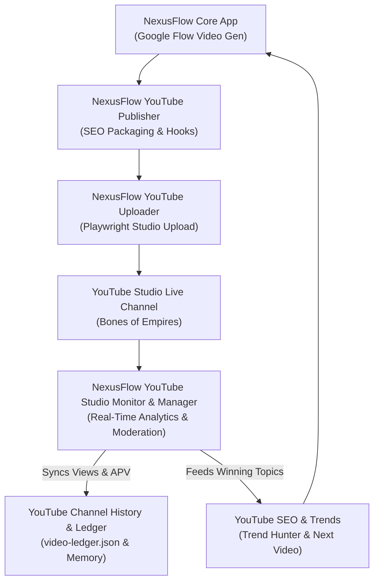

# NexusFlow YouTube Studio Monitor & Manager

> **Comprehensive YouTube Studio Monitoring, Real-Time Analytics & Channel Operations Suite for NexusFlow & Google Antigravity**

NexusFlow YouTube Studio Monitor & Manager completes the autonomous content lifecycle for the channel **Bones of Empires** (`@BonesOfEmpires`, Channel ID: `UCZXJSiKIw60aaUVBJv1ucCQ`). While other NexusFlow modules handle scene generation, video merging, SEO copywriting, and video uploading, this module provides the vital feedback loop: monitoring live Studio performance, tracking Shorts retention curves (APV), managing metadata and community comments, and feeding algorithmic success signals back into future content production.

---

## 🌟 Key Capabilities

1. **Live Studio Performance Monitoring**:
   - Real-time channel analytics: subscribers, 28-day views (3.2K+), watch time (13.7 hrs), and copyright/strike health.
   - Latest Short performance tracker with 10-rank velocity, views, likes, and **Average Percentage Viewed (APV)** retention diagnostics.
   - 48-Hour Velocity Radar identifying which published Shorts are receiving algorithmic browse boosts (e.g. *Pirates Almost Never Buried Their Treasure* with 1.1K+ views).

2. **Autonomous Channel Management**:
   - **Content Catalog Management**: Inspect, edit, and organize published videos and Shorts metadata.
   - **Community & Comment Moderation**: Auto-sentiment scanner, comment hearting, and persona-driven replies in the voice of **Marrow** (The Wandering Scribe).
   - **Pinned Engagement Prompts**: Synthesizes high-curiosity pinned questions designed to trigger comment debates.
   - **Monetization & YPP Milestone Radar**: Live visual progress tracking toward the 1,000 subscriber and 4,000 watch hour (or 10M Short view) thresholds.

3. **Two-Way NexusFlow Ecosystem Integration**:
   - Synchronizes live YouTube Studio stats back to `video-ledger.json` in `YouTube Channel History & Ledger`.
   - Sends winning topic and retention data back to `YouTube SEO & Trends` to prioritize high-performing historical topics.
   - Integrates with `NexusFlow YouTube Uploader` for session status and queue monitoring.

4. **Multiple Interfaces**:
   - **Interactive Web Dashboard**: Sleek dark-mode Studio Command Center at `http://localhost:3800`.
   - **Fast Operational CLI**: Direct terminal commands (`node cli.js status`, `node cli.js audit`, etc.).
   - **MCP Tool Suite**: 8 native Model Context Protocol tools for Antigravity and Gemini agents.

---

## 🚀 Quick Start

### 1. Check Channel Status
```bash
node cli.js status
```

### 2. Launch the Web Command Center
```bash
npm start
# or: node server.js
```
Open [http://localhost:3800](http://localhost:3800) in your browser.

### 3. Run Retention & Algorithmic Audit
```bash
node cli.js audit
```

### 4. Check Monetization Progress
```bash
node cli.js earn
```

### 5. Sync Live Stats into NexusFlow Ledger
```bash
node cli.js sync
```

---

## 🏗️ Architecture & Ecosystem Role



---

## 📁 File Structure

```
NexusFlow YouTube Studio Monitor & Manager/
├── config.js                 # Central directory and channel configuration
├── studioMonitor.js          # Live analytics engine & retention diagnostics
├── studioManager.js          # Operations, metadata updates, comment moderation
├── nexusflowBridge.js        # Two-way sync with sibling NexusFlow modules
├── server.js                 # Lightweight HTTP server for web dashboard
├── cli.js                    # Operational command-line interface
├── package.json              # Project definition & npm scripts
├── plugin.json               # Antigravity plugin manifest
├── install.ps1               # One-click MCP registration script
├── data/
│   └── studioState.json      # Channel snapshot & video catalog
├── public/
│   ├── index.html            # Dark-mode Studio Command Center UI
│   ├── styles.css            # YouTube Studio-inspired styling
│   └── dashboard.js          # Real-time UI controller & API client
├── skills/
│   └── youtube-studio-monitor/
│       └── SKILL.md          # Antigravity skill specification
└── mcp/
    └── server.js             # Stdio JSON-RPC MCP server
```

---

## 📊 Bones of Empires Initialized Baseline

| Metric | Verified Studio Value |
|---|---|
| **Channel Name** | Bones of Empires (`@BonesOfEmpires`) |
| **Channel ID** | `UCZXJSiKIw60aaUVBJv1ucCQ` |
| **Current Subscribers** | 6 (+6 in last 28 days) |
| **28-Day Views** | 3.2K (3,200) |
| **28-Day Watch Hours** | 13.7 hours |
| **Top 48h Video** | *Pirates Almost Never Buried Their Treasure* (1.1K views) |
| **Latest Upload** | *The Rupee Is Almost 500 Years Old* (APV: 50.6%, Rank: 6/10) |
| **Channel Health** | 100% Clear (0 strikes, 0 warnings) |
