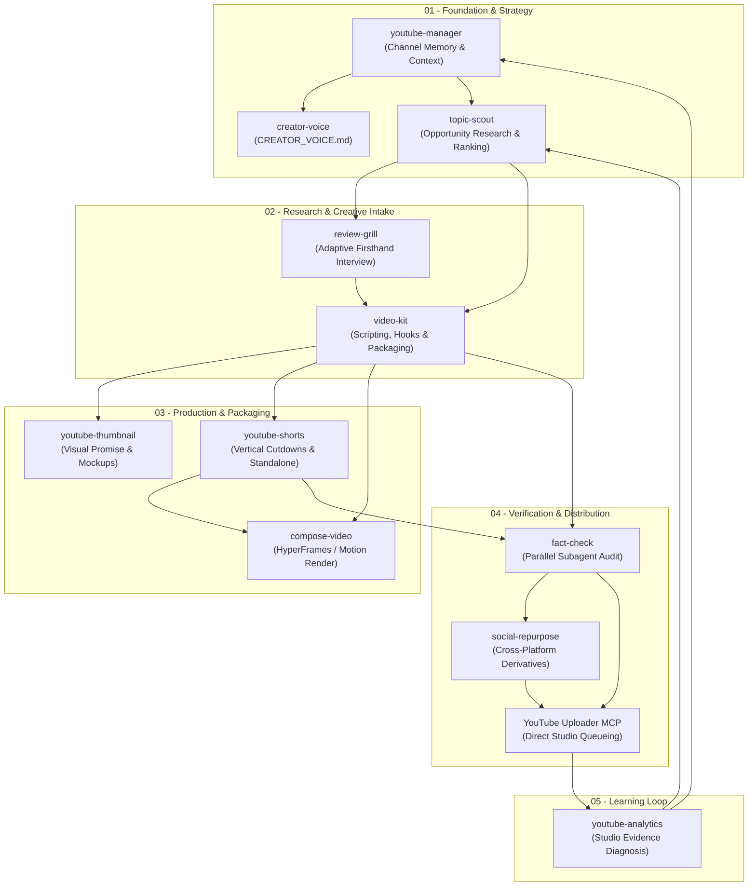

# Antigravity Multi-Agent Orchestration Guide

This guide defines how Google Antigravity (AGY) agents and subagents collaborate across the 11 skills in this repository.

## System Architecture

## Antigravity Subagent Orchestration

Antigravity provides reactive, asynchronous multi-agent coordination via `invoke_subagent`.

### 1. Fact-Check Parallel Workers
- **Lead Agent**: Coordinates claim extraction (`claims.md`), assigns atomic claims to workers, and compiles the final audit report (`audit-report.md`).
- **Research Workers**: Dispatched using `invoke_subagent` with `TypeName: "research"` and `Model: "flash"` or `"flash_lite"`.
- **Worker Prompt**: Includes Claim ID, normalized assertion, location, context, and the research worker contract from `skills/fact-check/references/research-contract.md`.
- **Reactive Wakeup**: The lead agent pauses until Antigravity wakes it up upon subagent completion, eliminating polling loops.

### 2. Topic Scout Discovery Agents
- **Market & Competitor Scanners**: Multiple subagents can be launched in parallel to scan distinct search queries, competitor recent uploads, and emerging discussions.
- **Synthesizer**: Evaluates demand, competition, channel fit, and creator feasibility, returning a ranked shortlist of up to 5 opportunities.

### 3. Visual Packaging & Thumbnail Generation
- When generating thumbnail visual concepts or mockups in `youtube-thumbnail`:
  - The agent creates the thumbnail brief (focal subject, crop, 3-5 word hook text, color palette).
  - Can invoke Antigravity's native `image-generator` subagent to render image variations or test mockups.

## NexusFlow & MCP Server Integration

When running in an environment with Antigravity MCP servers:

1. **NexusFlow Automation (`nexusflow`)**:
   - `nexusflow_get_prompts` / `nexusflow_update_prompt`: Pass structured video prompts generated by `video-kit` directly to automated pipeline queues.
   - `nexusflow_list_output_videos`: Inspect generated footage clips for editing in `compose-video` or `youtube-shorts`.
   - `nexusflow_merge_videos`: Losslessly concatenate scene clips into a single render.

2. **NexusFlow YouTube Uploader (`youtube-uploader`)**:
   - `youtube_probe_video`: Inspect video resolution, codec, duration, and audio before publishing.
   - `youtube_add_to_queue`: Automatically queue the finished video or Short with title, description, tags, and category.
   - `youtube_upload_video`: Upload directly to YouTube Studio upon user confirmation.

3. **Web Search (`search_web`)**:
   - Primary research engine for `fact-check`, `topic-scout`, and `review-grill`. All source URLs and verification dates are captured directly.

4. **Command Execution (`run_command`)**:
   - Executes local Faster-Whisper ASR via `skills/youtube-manager/scripts/setup_local_asr.ps1` and `transcribe_youtube.py`.
   - Runs local HyperFrames CLI (`npx hyperframes render`) and FFmpeg processing.

## Human Approval Gates (Non-Negotiable)

1. **Channel Memory**: Always present the drafted channel profile to the creator. Never write or update `CHANNEL_MEMORY.md` without explicit confirmation.
2. **Firsthand Reviews**: The creator is the sole source of truth for personal experience in `review-grill`. Never fabricate test results or ratings.
3. **Packaging Before Scripts**: Offer title alternatives and hook variants before locking full scripts.
4. **Rendering & Export**: Inspect static mockups or preview frames before committing to final video renders.
5. **Publishing**: Never execute live uploads without explicit creator confirmation.
